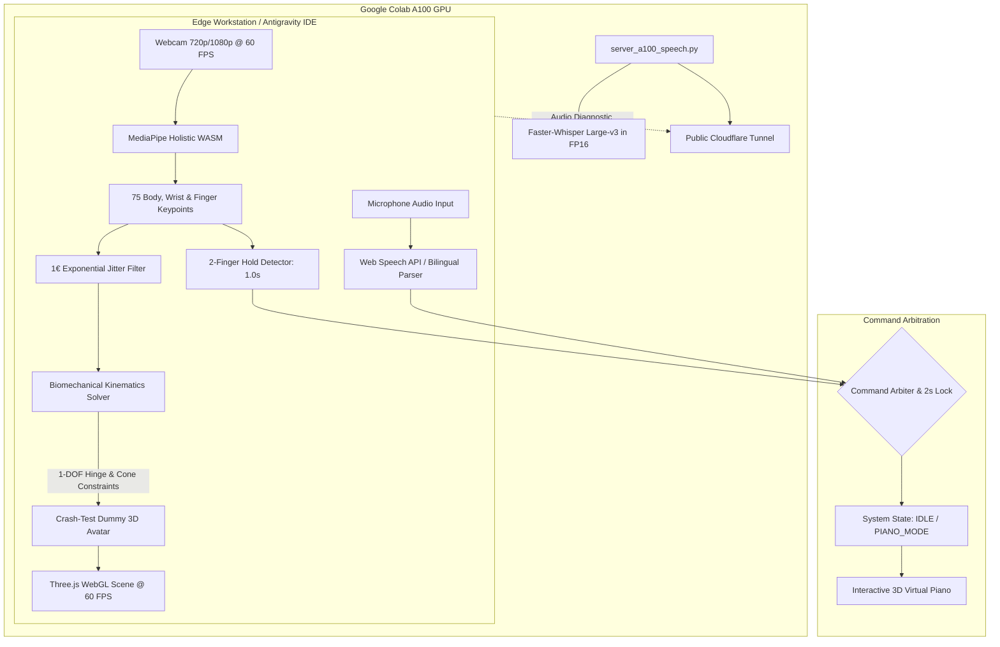

# ⚡ Real-Time 1:1 Motion Tracking Digital Twin Lab

[](https://nodejs.org/)
[](https://threejs.org/)
[](https://developers.google.com/mediapipe)
[](https://www.nvidia.com/)
[](https://opensource.org/licenses/MIT)

A high-performance **real-time 1:1 human digital twin mirror** featuring an articulated **Crash-Test Dummy (Hybrid III style)**, mathematical **One-Euro (1€) joint smoothing**, anatomical biomechanical constraints (1-DOF elbow hinge), dual voice/gesture command arbitration, and an interactive **3D virtual piano** with Web Audio sound synthesis.

---

## 🏛️ System Architecture



---

## 🚀 Key Features

1. **Procedural Crash-Test Dummy Avatar (`dummy_avatar.js`)**:
   - Signature automotive safety yellow chassis with steel joints and targeting crosshairs.
   - Fully articulated standard humanoid bone hierarchy matching Three.js / VRM / Kalidokit specifications.

2. **Biomechanical Constraints & 1-DOF Joint Limits (`kinematics_solver.js`)**:
   - **Elbow 1-DOF Hinge**: Restricts forearm movement to natural flexion ($0^\circ$ to $140^\circ$), completely preventing unnatural dislocations, backward hyperextension, or sideways twisting.
   - **Shoulder Cone Limit**: Enforces human physiological range of motion so arms never penetrate the torso or spine.
   - **Cervical Spine Clamping**: Head pitch ($-25^\circ \dots +28^\circ$), yaw ($-43^\circ \dots +43^\circ$), and roll ($-20^\circ \dots +20^\circ$).
   - **10-Finger Articulation**: Calculates independent curl angles for all 10 fingers (Thumb, Index, Middle, Ring, Pinky).

3. **Mathematical Motion Smoothing (`one_euro_filter.js`)**:
   - Implements the Casiez et al. **One-Euro (1€) filter** across all joint vectors.
   - Eliminates webcam pixel jitter when holding still, with zero lag during fast gestures.

4. **Interactive 3D Virtual Piano (`virtual_piano.js`)**:
   - Real-time 3D collision boxes detecting contact with the avatar's fingertips.
   - Low-latency Web Audio API polyphonic sound synthesis.
   - Real-time height adjustment controls (**`▲ Up`** / **`▼ Down`**) to align with your desk height.

5. **Dual Command Arbiter (`command_arbiter.js`)**:
   - **Bilingual Voice Recognition**: English (*"piano mode"*, *"stop piano"*) and Romanian (*"deschide pianul"*, *"opreste pianul"*, *"reseteaza"*).
   - **2-Finger Gesture**: Raise Index + Middle fingers for 1.0 second with an animated circular progress bar.
   - **Anti-Accident Lock**: Automatically places a 2.0-second cooldown lock on gestures after any trigger to eliminate double-firing.

6. **Cloud AI Backend (`server_a100_speech.py`)**:
   - Containerized Faster-Whisper Large-v3 server running on an NVIDIA A100 GPU via Colab CLI.
   - Latency probe benchmark tool (`benchmark_colab_latency.py`).

---

## 🛠️ Getting Started

### Prerequisites
- [Node.js](https://nodejs.org/) v18+ (tested on Node v24)
- Modern web browser with WebGL & Web Audio support (Chrome, Edge, Brave)
- Webcam and microphone

### Installation & Launch

```bash
# Clone the repository
git clone https://github.com/lefterpatrickandrei-sketch/Realtime-Digital-Twin-Lab.git
cd Realtime-Digital-Twin-Lab

# Install dependencies
npm install

# Start local development server
npm run dev
```

Navigate to `http://localhost:5173/` in your browser.

---

## 🎮 Controls & Interaction

| Interaction | Action | Effect |
| :--- | :--- | :--- |
| **Start Camera** | Click `📷 Start Camera` | Engages webcam and starts 60 FPS mirror tracking |
| **Voice: Open Piano** | Say *"piano mode"* or *"deschide pianul"* | Spawns the 3D virtual piano in front of avatar |
| **Voice: Close Piano** | Say *"stop piano"* or *"opreste pianul"* | Hides the virtual piano and returns to IDLE |
| **Voice: Reset View** | Say *"reset"* or *"reseteaza"* | Recalibrates camera position |
| **Gesture: 2 Fingers** | Raise Index + Middle fingers (Hold 1.0s) | Toggles the 3D piano |
| **Piano Height** | Click `▲ Up` or `▼ Down` | Adjusts keyboard height to match desk |

---

## 📄 License
This project is licensed under the MIT License - see the LICENSE file for details.
